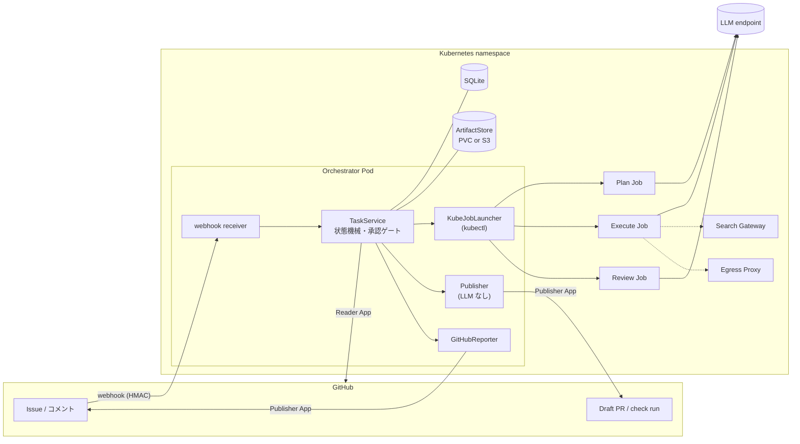
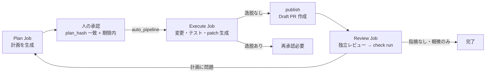
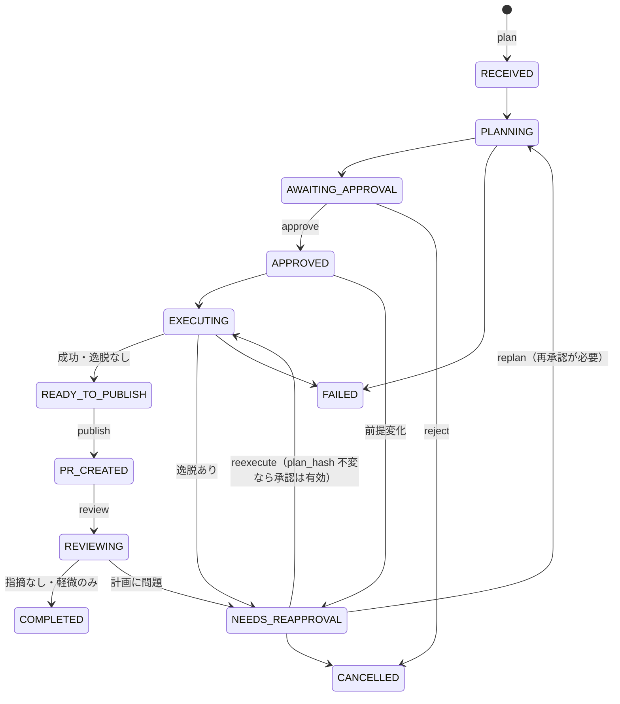

# 詳細設計

この文書は github-agent-platform のアーキテクチャと、各コンポーネントの設計判断をまとめたものです。概要は [overview.md](./overview.md)、導入手順は [usage.md](./usage.md) を参照してください。

## 目次

1. [設計原則](#1-設計原則)
2. [全体アーキテクチャ](#2-全体アーキテクチャ)
3. [処理フローと状態機械](#3-処理フローと状態機械)
4. [承認ゲートと plan_hash](#4-承認ゲートと-plan_hash)
5. [エージェントランタイム](#5-エージェントランタイム)
6. [Sandbox Job](#6-sandbox-job)
7. [Publisher と Review](#7-publisher-と-review)
8. [Webhook 受信](#8-webhook-受信)
9. [ネットワーク egress](#9-ネットワーク-egress)
10. [Web 検索](#10-web-検索)
11. [永続化・artifact・監査](#11-永続化artifact監査)
12. [セキュリティモデル](#12-セキュリティモデル)
13. [インフラ構成（IaC）](#13-インフラ構成iac)
14. [コード構成](#14-コード構成)
15. [既知の制約](#15-既知の制約)

---

## 1. 設計原則

| 原則 | 内容 | 強制する場所 |
|---|---|---|
| 承認ゲートは絶対 | コード変更・公開は、有効な承認レコード（期限内・plan_hash 一致）がある場合のみ | `TaskService.require_active_approval()` |
| credential 分離 | 読み取り（Reader App）/ 書き込み（Publisher App、LLM なし）/ LLM キー（Job のみ）/ Sandbox（credential なし）を分ける | Terraform（Secret のマウント先）、Job テンプレート、Publisher |
| 非信頼入力 | Issue 本文・PR コメント・リポジトリ内文書・テスト出力・検索結果は全て非信頼 | prompt のタグ封入、構造化出力の検証、NetworkPolicy |
| 失敗は表面化 | 欠落・破損・不一致を握りつぶす fallback を置かない | 型付き例外、hash 再検証、DB schema version の明示拒否 |
| 境界はコードとインフラで | prompt の指示だけで権限を守らない | Pod Security、NetworkPolicy、RBAC、Publisher の patch 検査 |
| secret は環境変数（Secret）のみ | argv・prompt・ログ・成果物・DB に入れない | `redaction.py`、canary テスト |

## 2. 全体アーキテクチャ



- Orchestrator は単一レプリカ（SQLite のため）。`agentctl webhook serve` として動き、同じイメージに `agentctl` の全サブコマンドが入っています（`kubectl exec` で手動操作可能）。
- Worker イメージは 1 つで、Orchestrator・3 種の Job・Search Gateway が共用します。役割はコマンドで切り替えます（`python -m agent_platform.worker.plan` など）。
- Job は one-shot で、完了後は TTL で削除されます。結果はログ中のマーカー（`PLAN_RESULT_BEGIN` 等）から回収します（完了した Pod には exec/cp できないため）。

## 3. 処理フローと状態機械





遷移表は `src/agent_platform/domain/state_machine.py` が唯一の定義で、契約テストで図と同期しています。

**冪等性**

- すべての状態遷移は `BEGIN IMMEDIATE` トランザクション内の compare-and-swap。同じ遷移の再実行は `ALREADY_APPLIED`。
- `idempotency_keys` テーブルがコマンドと task を束縛。同一 plan の再実行は新しい task を作らず既存を返す（`duplicate: true`）。
- 同一 `(task_id, plan_hash)` の二重承認は DB の UNIQUE 制約で拒否。1 つの承認から複数の Execute Job は作れない。
- 再 publish は同じブランチ（`agent-platform/<task_id>`）・同じ PR を返す。
- DB schema には version（現行 `8`）があり、異なる version の DB は明示的に拒否します（自動マイグレーションはしない）。

**複数リポジトリ（DAG）と契約**

- 親子 task は `task_dag_edges` で表現し、親が完了していない子の execute は拒否します（自動起動はしない）。循環 edge は作成時に拒否。
- リポジトリ間の API 合意は「契約」として name + semver の content-addressed artifact で不変保存し、consumer は digest で pin します（`agentctl contract publish / pin / consumers`）。

## 4. 承認ゲートと plan_hash

- **plan_hash**: PlanResult の canonical JSON（キー順ソート、区切り空白なし、UTF-8、NaN 不可、`plan_hash` フィールド自身は除外、float 不使用）の SHA-256。artifact の digest と一致する不変式を保ちます。エージェントが返した hash は信用せず、Orchestrator が再計算します。
- **承認レコード**: 承認者・承認時刻・期限（既定 72 時間、`AGENT_PLATFORM_APPROVAL_TTL_HOURS`）・許可ファイル（計画の `proposed_changes`）・テストコマンドを記録します。
- `require_active_approval()` が execute / publish / reexecute の前の唯一の入口で、レコードなし・期限切れ・hash 不一致・状態不適をすべて型付き例外で拒否します。webhook 経由の自動パイプラインでも各段階で再検証します。
- 計画を修正すると plan_hash が変わるため再承認が必要です。plan_hash が変わらない実装のやり直し（reexecute）は既存承認のまま有効です。
- 質問付きの計画（`requires_human_input=true`）は承認できません（変更対象がないため）。空の計画は人に届く前に FAILED になります。
- 自己承認の防止: 承認できるのはリポジトリの書き込み権限者（`approvers` を設定するとさらに絞り込み）。運用上は起動者と別の人が承認してください。

## 5. エージェントランタイム

エージェント CLI は `AgentRuntime` プロトコル（`src/agent_platform/agent_runtime/base.py`）の背後に隠蔽されています。

```python
class AgentRuntime(Protocol):
    name: str
    def run(self, *, prompt: str, mode: RunMode, cwd: Path | None = None,
            output_schema: Path | None = None) -> RunOutcome: ...
```

| | Codex（`codex`） | Claude Code（`claude-code`） |
|---|---|---|
| 起動 | `codex exec --json -` | `claude -p --output-format json` |
| エンドポイント | OpenAI Responses 互換（`agent_base_url`。例: さくらの AI Engine `https://api.ai.sakura.ad.jp/v1`。未設定なら OpenAI） | Anthropic 互換（`ANTHROPIC_BASE_URL`。例: AI Engine `https://api.ai.sakura.ad.jp`。未設定なら Anthropic API） |
| API キー | 生成した `$CODEX_HOME/config.toml` の `env_key` で環境変数名を指定（`Authorization: Bearer`） | 子プロセスの `ANTHROPIC_API_KEY`（`x-api-key`）、`agent_auth_scheme = "bearer"` なら `ANTHROPIC_AUTH_TOKEN`（`Authorization: Bearer`）に値を渡す |
| READ_ONLY | `--sandbox read-only` | `--allowedTools Read,Grep,Glob,LS`、書き込み系・Web 系ツールを禁止 |
| WRITE | `--sandbox danger-full-access`（隔離は Pod 境界） | `--permission-mode bypassPermissions`（隔離は Pod 境界）、Web 系ツールは禁止 |
| 構造化出力 | `--output-schema`（ゲートウェイ互換に変換したスキーマ） | スキーマを prompt に埋め込み、最終メッセージから JSON を抽出 |

共通の契約:

- API キーの値は argv・prompt・ログ・結果に入りません。値は環境から子プロセスへ直接渡ります。Job では Secret `llm-api-key` を `secretKeyRef` で `LLM_API_KEY` として注入します。
- タイムアウトは `AdapterTimeoutError`、起動失敗は `AdapterError`。非ゼロ終了やエージェント自身が報告した失敗は `RunOutcome` として返し、呼び出し側が判断します（計画はエラー、実装は violation として記録）。
- 監査用には `RunOutcome.audit_line()`（イベント数・トークン使用量のみ）をログに出し、メッセージ本文は出しません。
- 構造化出力は最終的に必ず pydantic モデルで検証します。スキーマ変換やプロンプト埋め込みは出力を狭めるだけで、検証を緩めることはありません。

**WRITE モードで CLI 自身の sandbox を使わない理由**: Codex の workspace-write sandbox は bubblewrap のユーザ名前空間を必要としますが、Pod Security Standards `restricted` 下では使えません。代わりに Pod 境界（非 root、read-only rootfs、capability 全削除、seccomp、SA トークン非マウント、default-deny egress、credential なし）を隔離層とします。

新しいランタイムの追加方法は [extending.md](./extending.md#エージェントランタイムを追加する) を参照してください。

## 6. Sandbox Job

テンプレートは `deploy/jobs/{plan,execute,review}-job.yaml` にあり、`KubeJobLauncher`（`adapters/kubernetes/kube.py`）が `{{PLACEHOLDER}}` 置換で描画して `kubectl apply` します（テンプレートエンジン依存なし）。

| | Plan Job | Execute Job | Review Job |
|---|---|---|---|
| ワーカー | `agent_platform.worker.plan` | `agent_platform.worker.execute` | `agent_platform.worker.review` |
| エージェントモード | READ_ONLY | WRITE | READ_ONLY |
| 入力 | Issue タイトル・本文 | 承認済み計画、許可パス、テストコマンド、スナップショット | Issue、計画、diff、テスト結果 |
| 出力 | PlanResult | ExecutionResult + patch | ReviewResult |
| ワークスペース | なし | `/workspace/repo`（init container がスナップショットを展開） | なし |

**NetworkPolicy の適用待ち**: CNI によっては（k3s 同梱の kube-router など）、新しい Pod のポリシーが Pod の起動より少し遅れて適用されます（k3s で約 1 秒、その間は通信が無制限）。各ワーカーはエージェントを起動する前に、どの egress レベルでも遮断されるはずの宛先（Kubernetes API の Service）に接続できなくなるまで待ちます。既定 30 秒以内に遮断されなければ、エージェントを起動せずに失敗します（fail-closed。`AGENT_PLATFORM_NETWORK_GUARD_SECONDS`）。

全 Job 共通のセキュリティ設定: `runAsNonRoot`（uid 10001）、`readOnlyRootFilesystem`、`capabilities.drop: [ALL]`、`seccompProfile: RuntimeDefault`、`allowPrivilegeEscalation: false`、`automountServiceAccountToken: false`、CPU / メモリ / ephemeral-storage の limit、`activeDeadlineSeconds`、`ttlSecondsAfterFinished`、`backoffLimit: 0`。書き込み可能なのは emptyDir の `/tmp`・`/out`・`/home/worker`・`/workspace` のみです。

**Execute Job の処理**（`worker/execute.py`）

1. スナップショットの HEAD が承認時の base SHA と一致するか確認（不一致は失敗）。
2. エージェントを WRITE モードで実行。
3. `git status` から変更ファイルを収集し、許可パス外の変更を `out_of_scope_path` violation として記録。`__pycache__` / `*.pyc` は除外。
4. 未追跡ファイルを含めて patch を生成（サイズ上限超過は violation）。
5. 承認されたテストコマンドを実行し、コマンド・終了コード・出力（先頭 4KiB）を監査記録。
6. ExecutionResult（`status` が唯一の真実）と patch を出力。violation があっても `succeeded` のまま返し、Orchestrator が `NEEDS_REAPPROVAL` に回します。

## 7. Publisher と Review

**Publisher**（`publisher/`）は LLM もリポジトリ内のスクリプトも実行しません。

1. Orchestrator 側の承認ゲートを通過した後、Publisher が patch を独立に検査（許可パス、バイナリ、シンボリックリンク、サブモジュール、サイズ）。変更ファイルは patch の diff ヘッダから導出し、ワーカーの申告と食い違えば拒否。
2. base SHA から `agent-platform/<task_id>` ブランチを作って patch を適用し push。push のトークンは `http.extraHeader` を環境変数経由で渡し、argv に出しません。
3. 同じブランチの PR がなければ Draft PR を作成し、計画の要約（summary・提案ファイル・テストコマンド）をコメント。

**Review** は Draft PR の diff を入力に、実装とは別のエージェントコンテキストで行います。指摘ごとに severity・path・message・evidence を返し、Orchestrator は **evidence が diff 内に実在するか** を機械的に確認します（実在しない指摘はブロック要因にしない）。結果は PR head への check run として投稿されます。投稿するのは構造化フィールドのみで、Issue 本文やエージェントの生出力は投稿しません（非信頼内容の二次配布防止）。

## 8. Webhook 受信

`agentctl webhook serve`（`webhook.py`）が GitHub App の webhook を受けます。

- `X-Hub-Signature-256` の HMAC を検証。delivery ID で重複排除。
- `issue_comment` の `/agent-platform <command>` を解釈（`run` / `answer` / `approve` / `redo`）。
- 起動者・承認者は **リポジトリの書き込み権限者**（Reader App で collaborator permission を確認、判定不能なら拒否 = fail-closed）。`allowed_kickers` / `approvers` でさらに絞り込めます。
- 計画の結果、質問、途中停止（逸脱・失敗・レビューで計画に問題）を Issue にコメントします（Publisher App の Issues: write が必要）。
- `auto_pipeline: true`（既定）のとき、承認後に execute → publish → review を自動で進めます。
- 設定は `<home>/webhook_config.json`（Terraform では ConfigMap `webhook-config`）。

## 9. ネットワーク egress

Execute Job の外向き通信は **デプロイ単位で 1 つのレベル**（`egress_level`）です。task・Issue・計画からは変えられません。

| レベル | 許可先 | 実現方法 |
|---|---|---|
| `none`（既定） | LLM エンドポイント + DNS | ベースラインの NetworkPolicy のみ |
| `allowlist` | + `egress_allowed_hosts`（例: PyPI） | smokescreen egress proxy（ホスト名 ACL、内部アドレス拒否）+ NetworkPolicy（execute → proxy のみ、proxy → 公開アドレスの 443 のみ） |
| `full` | + 公開アドレスの 443 | NetworkPolicy の ipBlock |

- Orchestrator が Execute Job の Pod に `agent-platform.egress=<level>` ラベルと（allowlist 時）`HTTPS_PROXY` / `NO_PROXY` を付与し、Terraform が描画した NetworkPolicy がこのラベルを選択します。ワーカーは SA トークンを持たないため自分のラベルを変えられません。
- LLM エンドポイントはプロキシを経由せず直接通信します（`NO_PROXY` にホストを入れる）。
- 異なるレベルが必要なリポジトリは **別デプロイ（別 namespace / クラスタ）+ 別 GitHub App** で扱い、1 つのリポジトリに複数の App をインストールしません（同じコメントに複数のデプロイが反応するため）。
- 承認者は Issue の計画コメントの `execute network:` 行でレベルを確認できます。

**ベースラインの NetworkPolicy**（`infra/platform/namespace.tf`）

- namespace 全 Pod の ingress / egress を default-deny。
- 全 Pod に kube-system への DNS（53/UDP,TCP）。
- エージェント Job（`app.kubernetes.io/part-of=agent-platform`）に LLM エンドポイント（`llm_egress_cidrs` の `llm_egress_port`）。`llm_egress_cidrs` が空の場合は「公開アドレス全体の 443」になります。SaaS API はアドレスが変わるため実質これしか選べませんが、自前のエンドポイントなら CIDR を固定してください。
- Orchestrator は API サーバ（Endpoints から自動取得）と GitHub / S3 向けの 443（`orchestrator_egress_cidrs`、既定は公開アドレス全体）。

## 10. Web 検索

Execute 中のエージェントが使える Web 検索です。**既定は無効**で、`search_provider` で検索 API を選んだデプロイだけ有効になります。

```
Execute Job (worker)                     Search Gateway (Deployment)          検索 API
python -m agent_platform.search.cli ──▶  sanitizer 再実行 → rate limit ──▶  brave / http-json / ...
  sanitizer（禁止語彙・secret 形状）       ログは query の SHA-256 のみ         (443、Gateway Pod だけ)
```

- ワーカーは直接インターネットに出られません。検索はワーカー内の検索 CLI（唯一の入口）から Gateway 経由のみです。
- **禁止語彙は計画時に自動生成**: Issue 本文・スナップショットから識別子を抽出し、Execute Job の環境変数経由でサニタイザに渡します。
- **サニタイザが送信前に拒否**: secret の形状、内部 URL、ログ断片、ソースコード行、task 文脈のトークン。
- **Gateway はワーカーを信用しない**: サニタイザを再実行し、レート制限（全体 30 回/分・送信元ごと 10 回/分）をかけます。ログは query の SHA-256・件数・プロバイダ名のみ。
- API キーは Secret `search-api-key` から **Gateway Pod にだけ** 渡ります。
- 検索結果は非信頼データとして扱うよう prompt で指示しています。

| `search_provider` | 動作 |
|---|---|
| `none`（既定） | Gateway をデプロイしない。prompt に検索の案内を出さず、検索 CLI は全件拒否 |
| `fake` | 固定の 1 件を返す（配線確認用、Gateway に外部 egress なし） |
| `brave` | Brave Search API（上位 5 件）。`search_api_key` 必須 |
| `http-json` | 独自 API: `GET <search_provider_url>?q=<query>` → `{"results":[{"title","url","snippet"}]}`。https のみ、応答 1MiB まで、`Authorization: Bearer <key>`（キー設定時） |

> `none` 以外の実 API を選ぶと、**LLM が生成した検索クエリが外部の検索 API に送られます**。サニタイザが Issue 由来の語彙・secret 形状・コード行は拒否しますが、有効化は組織の外部送信ポリシーを確認してから行ってください。

## 11. 永続化・artifact・監査

- **DB**: SQLite（`<home>/state.sqlite3`、Orchestrator の PVC）。task・承認・状態遷移の監査ログ・冪等キー・DAG・契約を保持。DB の行には Issue 本文や LLM の入出力を直接入れず、artifact の参照（digest）・サイズ・retention class だけを置きます。
- **ArtifactStore**: content-addressed（SHA-256）。ローカル FS（PVC、0700/0600）または S3 互換ストア。読み出し時に必ず hash を再検証し、破損・改ざんは例外になります。
- **retention class**: `audit`（計画・実行結果など、判断の復元に必要なもの）と `ephemeral`。`agentctl artifacts gc` が期限切れの ephemeral を削除します（audit の削除は明示確認が必要）。
- **S3 直接 put**: S3 を設定すると、Orchestrator が 1 オブジェクト限定・短命の presigned PUT URL を発行し、Execute Job が直接アップロードします（ワーカーは長期 credential を持たない）。ログマーカーによる回収は常に併用されます。

## 12. セキュリティモデル

| 脅威 | 対策 |
|---|---|
| Issue 本文によるプロンプトインジェクション | 非信頼タグで封入。計画は構造化出力のみで、変更範囲は人が承認した許可パスに限定。逸脱は検知して公開しない |
| エージェントによる credential 窃取 | Sandbox に GitHub credential は存在しない。LLM キーは Job にのみ注入され、Orchestrator も読まない |
| エージェントによる外部送信・横移動 | default-deny NetworkPolicy。許可先は LLM エンドポイントと DNS（レベルに応じて proxy / 443）。SA トークン非マウント |
| 悪意ある patch（バイナリ、symlink、submodule、範囲外） | Publisher が LLM なしで独立検査し、diff ヘッダから変更ファイルを再導出 |
| 不正な起動・承認 | webhook 署名検証、collaborator 判定（fail-closed）、approvers 許可リスト、plan_hash 一致 |
| 計画のすり替え | plan_hash の再計算と承認の束縛。artifact の hash 再検証 |
| 検索クエリからの情報漏えい | ワーカーと Gateway の二重サニタイズ、禁止語彙の自動生成、Gateway のみが API キーを保持 |
| secret のログ混入 | 環境変数名ベースの redaction、canary テスト（植えた secret がログ全文に出ないことを検証） |
| サプライチェーン | ベースイメージ・codex バイナリ（npm SRI）・smokescreen（SHA256SUMS）を digest / hash で固定。デプロイするイメージも digest 固定 |

**運用上の注意**

- Terraform の state には Secret の値が含まれます。暗号化されたリモート backend に置き、アクセスを制限してください。
- GitHub App の秘密鍵はリポジトリ外（例: `~/.config/agent-platform/`、0600）に置き、Terraform の実行マシン以外に配らないでください。
- `full` / `allowlist` や検索の有効化はリスクを増やします。必要なデプロイだけで有効にしてください。

脆弱性の報告方法は [SECURITY.md](../SECURITY.md) を参照してください。

## 13. インフラ構成（IaC）

```
infra/
├── platform/            # クラウド非依存。任意の Kubernetes に本体をデプロイ（kubernetes provider のみ）
└── clusters/            # クラスタを用意するための例（任意）
    ├── kind/            # ローカル検証用
    └── sakura-k3s/      # さくらのクラウド上の k3s
```

`infra/platform` は kubeconfig だけを入力に、次を作成します。

| ファイル | リソース |
|---|---|
| `namespace.tf` | Namespace（PSS restricted）、worker SA、default-deny / DNS / LLM の NetworkPolicy、ResourceQuota、LimitRange |
| `secrets.tf` | `llm-api-key`、`regcred`（任意）、`github-app-keys` |
| `orchestrator.tf` | Orchestrator の Deployment・SA・Role・RoleBinding・Service・PVC・環境変数 Secret・webhook 設定 ConfigMap・NetworkPolicy |
| `egress.tf` | `egress_level` に応じた egress proxy 一式と NetworkPolicy |
| `search_gateway.tf` | `search_provider` に応じた Search Gateway 一式と NetworkPolicy |

クラスタの作り方（マネージド K8s、自前 k3s など）はこのリポジトリの外で自由に選べます。`infra/clusters/` は参考例です。

**クラスタに求める条件**

- NetworkPolicy を **強制する** CNI（Calico、Cilium、k3s 同梱の kube-router など）。強制しない CNI ではサンドボックスの通信制限が効きません。
- Pod Security Admission（Kubernetes 1.25+）。
- 既定の StorageClass（または `state_storage_class` の指定）。

## 14. コード構成

```
src/agent_platform/
├── cli.py                  # agentctl（argparse のみ）
├── config.py               # 環境変数からの設定（エージェントランタイムの選択を含む）
├── agent_runtime/          # エージェント CLI の抽象化（codex / claude-code）
├── worker/                 # Job 内で動くワーカー（plan / execute / review）
├── domain/                 # 状態機械・モデル・hash（I/O なし）
├── orchestrator/           # TaskService（ユースケース層）+ SQLite repository
├── adapters/
│   ├── agent/              # fake / local / remote（K8s Job）アダプタ
│   ├── artifacts/          # ローカル FS / S3 互換ストア
│   ├── github/             # Reader（GET のみ）+ App 認証
│   └── kubernetes/         # KubeJobLauncher
├── publisher/              # Draft PR 作成（LLM なし）
├── search/                 # 検索 CLI・サニタイザ・プロバイダ
├── search_gateway/         # Search Gateway（HTTP サーバ）
├── webhook.py              # GitHub webhook 受信
├── github_reporting.py     # Issue コメント・check run 投稿
├── prompt_builder.py       # 非信頼入力のタグ封入
├── egress.py               # egress レベル設定
├── redaction.py            # ログの secret 除去
└── codex_events.py / codex_schema.py   # codex 出力パーサ / スキーマ変換
deploy/
├── jobs/                   # Job テンプレート（Orchestrator が描画）
├── worker/Dockerfile       # Worker イメージ（エージェント CLI はビルド引数で選択）
└── egress-proxy/Dockerfile # smokescreen
schemas/                    # JSON Schema（pydantic モデルが正、生成物を commit）
infra/                      # Terraform
scripts/                    # build-push / create-snapshot / smoke
```

層の依存方向: `domain` ← `orchestrator` ← `cli` / `webhook`。`adapters` は Protocol（`AgentAdapter`、`JobLauncher`、`ArtifactStore`、`SearchProvider`）を実装し、`TaskService` は Kubernetes を知りません。

## 15. 既知の制約

- **Execute のリポジトリスナップショット**: Execute Job は、`snapshot_configmap` で指定された ConfigMap（git bundle）を展開して作業します。ConfigMap は手動で作成し（`scripts/create-snapshot.sh`）、1 つのデプロイで 1 リポジトリを扱う前提です。容量は約 1MiB まで。タスクごとに Orchestrator がスナップショットを生成する方式は今後の課題です。
- **Plan Job はリポジトリの中身を見ない**: 計画は Issue の内容から作られます（スナップショットのマウントは Execute のみ）。
- **単一レプリカ**: Orchestrator は SQLite のため 1 レプリカです。
- **Claude Code ランタイムの構造化出力**: スキーマを prompt で指示し、出力から JSON を抽出します。検証は pydantic で行うため不正な出力は失敗として扱われますが、Codex の `--output-schema` ほど強い制約ではありません。
- **監視**: メトリクス・アラートは含みません。Job の失敗は Issue コメントと `agentctl status`、Pod ログで確認します。
