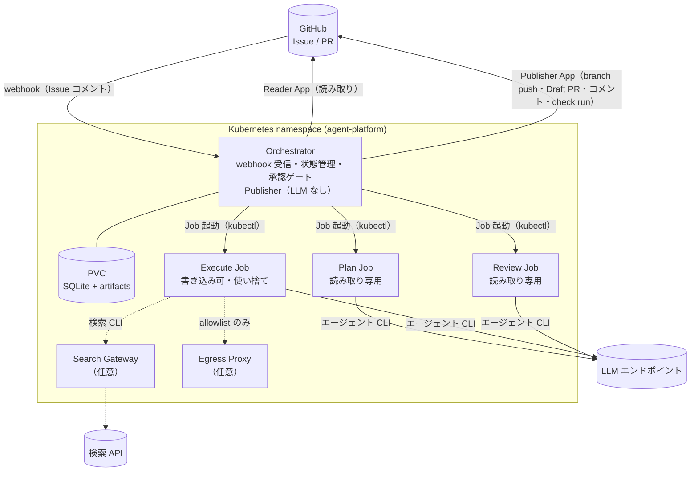

# 概要

github-agent-platform は、GitHub の Issue を入力として **AI コーディングエージェントが対応計画を立て、人が承認した後に、隔離された使い捨て Sandbox で実装・テストし、Draft PR を作成する**ための基盤です。

GitHub App として動作し、バックグラウンドの処理は Kubernetes 上の Job として実行されます。リポジトリをクローンし、環境変数（Terraform 変数）で **利用する AI エージェント・LLM エンドポイント・検索 API・クラウドリソース** を選ぶだけで、独自の Issue 対応 App を構築できます。

```
Issue ──▶ Plan Job ──▶ 人の承認 ──▶ Execute Job ──▶ Draft PR ──▶ Review Job
        (計画のみ)     (Issue上で)   (使い捨て Sandbox)  (LLMなしで作成)  (独立レビュー → check run)
```

## 何が嬉しいか

- **人の承認が絶対のゲート**: エージェントが自律的に行えるのは「計画の生成」まで。コード変更は、人が計画（の hash）を承認した後にしか起こりません。
- **エージェントに書き込み権限を渡さない**: Sandbox の Pod は GitHub の credential を一切持たず、通信先も LLM エンドポイントと DNS に限定されます。PR を作るのは LLM を実行しない別コンポーネント（Publisher）です。
- **計画は hash で凍結**: 承認は `plan_hash` に対して行われます。計画が変われば再承認が必要で、承認範囲外のファイル変更は「逸脱」として検知され公開されません。
- **差し替え可能**: エージェント CLI（Codex CLI / Claude Code）、LLM エンドポイント（さくらのクラウド AI Engine、OpenAI、Anthropic、vLLM などの互換 API）、Web 検索 API（Brave / 独自 API / 無効）、Kubernetes クラスタ（任意）を設定で選べます。
- **監査可能**: 計画・実行結果・patch・レビュー指摘は content-addressed な artifact として保存され、承認・実行・公開・レビューの全判断は監査ログから復元できます。

## 利用者が選ぶもの

| 項目 | 選択肢 | 設定先 |
|---|---|---|
| AI エージェント | `codex`（Codex CLI）/ `claude-code`（Claude Code） | `agent_runtime` |
| LLM エンドポイント | さくらのクラウド AI Engine、各ベンダー API（OpenAI / Anthropic）、または互換エンドポイント（vLLM、LiteLLM など） | `agent_base_url` / `agent_model` / `agent_api_key` |
| Web 検索 | `none`（既定）/ `brave` / `http-json`（独自 API）/ `fake` | `search_provider` |
| Sandbox のネットワーク | `none`（既定）/ `allowlist`（指定ホストのみ）/ `full` | `egress_level` |
| Kubernetes クラスタ | 任意（EKS / GKE / AKS / k3s / kind ...）。構築例: さくらのクラウド k3s、kind | `infra/clusters/` |
| GitHub | github.com または GitHub Enterprise Server | `github_api_url` |
| 成果物ストア | Orchestrator の PVC（既定）または S3 互換ストレージ | `s3` |

## 構成要素



| コンポーネント | 役割 |
|---|---|
| Orchestrator | GitHub webhook を受け、task の状態機械・承認ゲート・Job 起動・結果の検証を行う。Publisher（Draft PR 作成）も同居するが LLM は実行しない |
| Plan Job | Issue から「何を変えるべきか」を構造化された計画（PlanResult）として出力。コードは変更しない |
| Execute Job | 承認で凍結された計画を、base SHA に固定したリポジトリスナップショット上で実装し、承認されたテストコマンドを実行して patch を出力 |
| Review Job | 実装エージェントとは別コンテキストで diff をレビュー。指摘の根拠が diff 内に存在するかを機械的に確認 |
| Search Gateway | （任意）Execute Job からの検索クエリを再検査して検索 API に中継。API キーを持つのはこの Pod だけ |
| Egress Proxy | （任意、`allowlist` 時）Execute Job が指定ホスト（例: PyPI）にだけ出られるようにする HTTPS プロキシ |

## 人が行う操作

人が行うのは **計画の開始指示** と **承認** の 2 つだけです（計画が質問を返した場合は回答も）。どれも Issue へのコメントで行います。

| コメント | 動作 |
|---|---|
| `/agent-platform run` | 計画を作成し、結果を Issue にコメント |
| `/agent-platform answer <回答>` | 計画が「人の判断が必要」と質問したときに回答し、計画を作り直す |
| `/agent-platform approve` | 最新の計画を承認。以降 実装 → Draft PR → レビュー が自動で進む |
| `/agent-platform redo [task-id]` | 完了・失敗した task をやり直す（コメント本文は追加指示になる） |

PR は Draft のまま作られ、マージ判断は常に人に残ります。

## 次に読むもの

- [利用方法](./usage.md) — 導入手順と運用
- [詳細設計](./design.md) — アーキテクチャ・セキュリティモデル・各コンポーネントの設計
- [設定リファレンス](./configuration.md) — Terraform 変数と環境変数の一覧
- [拡張ガイド](./extending.md) — エージェント・検索 API・クラウドの追加方法
